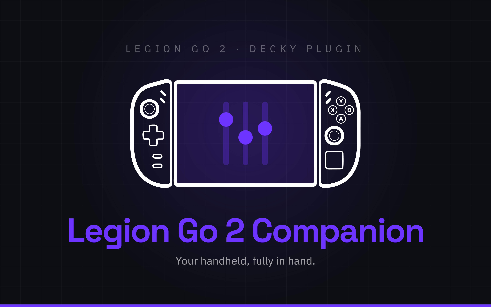

<div align="center">



[](https://github.com/Rayekkk/LegionGo2Companion/releases/latest)
[](https://github.com/Rayekkk/LegionGo2Companion/releases)
[](#requirements)
[](https://decky.xyz)
[](LICENSE)

**Your Legion Go 2 hardware controls, together in the Steam overlay.**
Tune power and vibration, personalise lighting and buttons, manage charging, and check your display and Wi-Fi without leaving Gaming Mode.

[Features](#features) · [Requirements](#requirements) · [Installation](#installation) · [Quick start](#usage) · [Technical details](#how-it-works) · [Troubleshooting](#troubleshooting)

</div>

---

## Features

Legion Go 2 Companion combines eight hardware modules in one Decky plugin. Use the
controls you need, hide the rest, and keep separate power and vibration settings for
your games. Saved profiles continue working while the menu is closed.

| Module | What you can do |
|---|---|
| [TDP](#tdp) | Choose four power presets or Custom limits, adjust CPU Boost and EPP, and save game profiles with separate battery/AC settings |
| [Vibration](#vibration) | Set handle vibration, touchpad feedback and game profiles; try a short vibration test |
| [RGB Lighting](#rgb-lighting) | Set the joystick-ring effect, colour, brightness and speed; control the power-button light on verified firmware |
| [Button Remapper](#button-remapper) | Give the left controller's Desktop and Page buttons separate actions |
| [Gyro & Touchpad](#gyro--touchpad) | Choose the controller motion source and compare controller readings with the output reaching Steam |
| [Battery](#battery) | Limit charging to about 80% and view the console and both controller batteries |
| [OLED Display](#oled-display) | Use display fixes on older systems and correct the HDR metadata that games read |
| [WiFi](#wifi) | Prefer higher bands with iwd, or make a one-time 5/6 GHz connection with WPA |

## Requirements

| Requirement | Details |
|---|---|
| Device | Lenovo Legion Go 2; see model compatibility below |
| System | SteamOS with [Decky Loader](https://decky.xyz) installed |
| Tested system builds | SteamOS **3.8.16 Stable (kernel 6.16.12)** and **3.10 (kernel 7.2)**; available controls depend on the system interfaces |

**Model compatibility:** the main validation device is **8ASP2 / 83N0**. Joystick RGB
also supports **8AHP2 / 83N1** when the expected Lenovo controller and complete
`hid-lenovo-go` lighting interface are present. An 8AHP2 owner confirmed RGB and
sleep/wake recovery on **SteamOS 3.9.1 Preview, build 20260914.100**. This covers
controller RGB; maintainers have not independently verified every feature on 8AHP2.

Each module checks its own hardware support and explains unavailable controls. The
**power-button light** additionally requires the verified **83N0 / RRCN16WW** BIOS
and ACPI layout. The 83N1 RGB extension does not extend that firmware access.

## Installation

1. Install [Decky Loader](https://decky.xyz) if you do not already have it.
2. Download `LegionGo2Companion-<version>.zip` from [Releases](https://github.com/Rayekkk/LegionGo2Companion/releases). Choose the plugin ZIP attached to the release.
3. Uninstall overlapping standalone plugins, keeping their saved settings as described below.
4. In Gaming Mode, open **Quick Access Menu → Decky → Settings → Developer**.
5. Choose **Install Plugin from ZIP**, select the archive, then open **Legion Go 2 Companion** in Decky.

Normal use needs no terminal commands. If you build your own ZIP, follow the
[development instructions](#development).

> [!IMPORTANT]
> Companion pauses **all modules** while **LeGoTDP**, **LeGo Vibe Control** or
> **LeGo2 Brightness Fix** is installed. Uninstall the named plugins in Decky Settings,
> keep their settings, then restart Decky or the console. Disabling them is not enough.
> **Check again** confirms that the conflict is gone; a restart is still required.

### Moving from standalone plugins

Keep the old plugins' Decky settings folders when uninstalling them. Companion imports
missing TDP, vibration, display and Wi-Fi settings; values already saved in Companion
take precedence. It leaves the original files intact. Deleted settings cannot be imported.

Companion's own settings live outside its installed plugin folder, so replacing the
plugin files preserves them. After installation, check **Manage Modules** and **OLED
Display**, where setup or a Gaming Mode restart may be requested.

### Updating

1. Open **About → Check for Updates**.
2. If a newer stable release has a downloadable plugin ZIP, choose **Download <version>**.
3. Wait for the confirmed download path in your Downloads folder.
4. Install that ZIP through **Decky Settings → Developer → Install Plugin from ZIP**.
5. Review your module settings afterwards, especially gyro, battery protection and Wi-Fi.

**Downloading does not install the update.** Decky's installation process can reset
those hardware preferences. Companion verifies the ZIP before offering the completed
file; if checking or downloading fails, the page shows the reason and you can try again.
Opening About alone does not contact GitHub.

## Usage

### Quick start

Open Companion in Decky. **Hardware Controls** shows a short status beside each module;
select a row to open its page, and use **‹ All Controls** to return. Dropdown selections
keep you on the current page.

1. Open **Manage Modules** and leave enabled the modules you want to use.
2. Open a module and check its status before changing a setting.
3. For game-specific TDP or vibration, launch the game first, then enable **Per Game Profile** on that page.
4. Wait for the result after a change. A saved preference can be waiting for hardware confirmation; check the current/applied state too.

The overview keeps the last received summaries when reopened. A note about old data
means a fresh status could not yet be confirmed. Changes remain saved across reboots;
managed profiles and supported controls recover after wake without reopening Decky.

### Manage Modules

Disabling a module stops its work, withdraws its hardware controls and hides its page.
Its saved preferences remain available when you enable it again. This differs from
turning off an individual setting: for example, **Joystick ring lights** can stay off
while RGB control remains active to keep them off after wake.

Restoration depends on the module:

| Module | When disabled |
|---|---|
| TDP & CPU | Returns TDP to the balanced firmware profile, CPU Boost to standard boost, and EPP to `balance_performance` |
| Vibration | Returns to driver defaults |
| RGB, Button Remapper, Gyro & Touchpad, Battery | Restores the captured state for controls still owned by Companion |
| WiFi | Restores the configuration Companion changed; Wi-Fi may briefly reconnect |
| OLED Display | Withdraws display adjustments and its script; Gaming Mode may need a restart |

If cleanup cannot finish, the module stays blocked and offers **Retry <module> Cleanup**.
An enabled module that could not start offers **Retry <module> Start**. Recovery records
are retained and unfinished cleanup is retried on startup. **Restart Gaming Mode (closes
games)** ends the current gaming session, so save and close your games first.

### TDP

Use **Enable** to give Companion control of the power limits, then choose a preset.
**CPU Boost** and **EPP** are independent controls in the same page.

#### Presets and Custom

Four presets are available, plus **Custom**. SPL is sustained power; SPPT and FPPT allow
higher power for slower and shorter bursts. These are APU limits, not the whole console's
battery consumption.

| Preset | SPL: sustained | SPPT: slow burst | FPPT: fast burst |
|---|---|---|---|
| Silent | 8 W | 15 W | 20 W |
| Balanced | 16 W | 25 W | 30 W |
| Performance | 20 W | 32 W | 35 W |
| Full Power | 35 W | 37 W | 45 W |

Presets apply immediately to the active profile. In **Custom**, adjust the sliders and
use **Apply TDP**, **Apply & Save for <game>** or **Save AC for <game>**, depending on
which profile you are editing.

**Advanced TDP Control** is on by default and shows all three limits. Turn it off for
one **TDP** slider: normally 5–35 W, with SPPT following at +10 W up to 37 W and FPPT
at +15 W up to 45 W. The available range is checked against your firmware.

**Profile overview** identifies the profile you are editing, its selected limits and
whether AC is connected. **Current TDP** shows hardware limits and live **Package draw**;
the latter is the APU power reading.

#### Game and charging profiles

With a game running, turn on **Per Game Profile** to save its TDP, CPU Boost and EPP
settings. Turn on **Separate AC Profile** if you want different settings while charging.
Use **Battery profile** and **AC profile** to choose which one to edit.

The charger selects which profile applies on the hardware. Editing the inactive profile
saves it for later without changing the current hardware settings. Leaving the game,
turning off its profile, or playing a game without a profile returns to the global choices.
New game profiles start with the current choices; older profiles without CPU settings
inherit the global CPU choices until edited.

#### CPU Power Controls

**CPU Boost** allows or disables turbo frequencies. **EPP** controls the CPU's energy
preference: **Prefer CPU** favours CPU performance; **Prefer GPU** reduces CPU energy
demand and can leave more of the shared power budget for graphics.

Newer kernels expose a **0–100% slider in 10% steps**: 0% is Prefer CPU and 100% is Prefer
GPU. Older kernels expose supported named preferences, including **System default**
when available. Companion uses the closest supported preset while keeping the exact
saved value for systems that can apply it. CPU changes save automatically to the profile
shown above the controls and are checked against the kernel.

#### Extras

**Unlock Custom TDP to 50 W** extends the three Custom limits up to 50/50/50 W using the
optional `ryzenadj` helper. If the helper is temporarily unavailable, normal firmware
limits remain available and your profiles are kept. Use **Retry Extras download** when offered.

> [!WARNING]
> The 50 W range exceeds the manufacturer's normal firmware limits. It can increase
> heat and power use, and the hardware can still constrain the request. Enable it only
> if you intend to use that range.

If status or a profile could not load, use **Retry status** or **Retry profile** and wait
for fresh values before editing.

### Vibration

Set **Intensity** for both handles: Off, Low, Medium or High. **Mode** selects the
vibration pattern; the choices come from the driver and can include FPS, Racing,
Standard, SPG and RPG. **Touchpad vibration** and **Touchpad intensity** are separate.

Changes save automatically. With a game running, **Per Game Profile** switches between
that game's haptics and the global settings. Saved game profiles apply when their game
starts, and global settings return when you leave it or turn its profile off.

- **Test Vibration (0.5s)** tests the selected handle intensity and mode.
- **Reset to defaults** resets the currently selected global or game profile.
- **Show driver details** expands the controller interface information for diagnosis.
- **Retry settings** reloads settings after a load failure.

Controller reconnection and wake reapply saved haptics once the driver is available.

### RGB Lighting

Turn on **Enable RGB control**, then use **Joystick ring lights** to switch both rings
on or off. Choose a **Lighting effect** and adjust the controls it uses:

| Effect | Controls |
|---|---|
| Solid | Hue, saturation and brightness |
| Breathing | Hue, saturation, brightness and speed |
| Color cycle | Brightness and speed |
| Rainbow | Brightness and speed |

The two previews show the selected colour for Solid and Breathing. Changes save
automatically; the controller runs the animations. Saved settings, including lights off,
are reapplied after startup and wake when the controller becomes available.

**Power button light** is separate and available only on the verified firmware described
in [Requirements](#requirements). **Restore lighting state from before Companion**
restores the captured lighting state and releases Companion's lighting control.

### Button Remapper

Turn on **Enable button remapping**, then choose separate actions for the left
controller's **Desktop button** (upper extra button) and **Page button** (lower extra
button). Options include Steam menus, the on-screen keyboard, screenshots, window
switching, navigation keys and F1–F12. **Disabled** makes a button produce no action.

**Default** restores that button's captured system mapping. **Restore Default Actions**
restores both. Turning remapping off restores mappings Companion still owns while
preserving unrelated mappings and changes made elsewhere. Actions are saved and
reapplied through SteamOS's existing InputPlumber service.

### Gyro & Touchpad

Choose **Controller motion source**: **Left controller**, **Right controller**,
**Both controllers (average)** or **System default**. Selecting a controller enables its gyro reporting and routes its
motion through InputPlumber. These sensors are in the removable handles; Both averages
their readings. The page shows the current route separately from the saved choice.

**System default** or **Release Companion Control** restores the previous settings still
owned by Companion. If an interrupted change is reported, use the release action to
recover before making another change.

For a quick check, choose **Start 30-Second Test**, move each controller and touch the
touchpad. Compare **Physical controllers** with **Existing Steam controller** to see
whether input reaches the virtual controller. **Stop Test** ends it early; it also stops
after 30 seconds or when the page is hidden. Zero readings and missing reports are
shown separately.

The test observes existing reports. It does not enable sensors, calibrate the console
body or configure a game's Steam Input layout. You still need gyro/touchpad assignments
in that game's controller layout. Raw test values are diagnostic counts, not degrees
per second.

### Battery

**Charging state** shows the console battery and charging status. **Battery protection**
uses Lenovo's Long Life mode to limit charging to **about 80%**. The percentage is fixed
by firmware. If the battery is already above the limit, enabling protection does not
actively discharge it.

Turning protection off restores the previous normal charging mode, including **Fast**
when it was active. **Release Companion Control** returns the captured state and stops
maintaining a charging preference. If a change was interrupted, use **Recover and
Release Control** first. The page distinguishes the saved preference from the battery's
confirmed state. First installation leaves the charging mode alone until you choose it.

**Controller batteries** shows separate left/right charge levels and connection states.
Detached controllers are labelled separately, with a controller-reported level when available.

### OLED Display

The available controls depend on whether SteamOS already supplies the Legion Go 2
OLED display profile.

**With native display support:** Companion retires its older brightness/display fix and
removes its recognised user script. PQ, Gamma 2.2, Hybrid and brightness forwarding are
locked with an explanation. **EDID for games** remains available independently. Cleanup
retries automatically if needed; use **Restart Game Mode** when requested to finish
the handover.

**On older systems:** choose a mode at first setup, or use **Switch Display Mode** later.

| Mode | What it does | What you may notice |
|---|---|---|
| Hybrid (recommended) | Uses Gamma 2.2 for SDR and switches to PQ for HDR content | The panel briefly blanks when the mode changes |
| PQ | Keeps the panel in its HDR transfer function | SDR dimming through gamescope can raise the apparent black floor |
| Gamma 2.2 | Keeps direct panel brightness control | HDR highlights are tone mapped into a lower luminance range |

**Brightness slider → Enabled** forwards Steam's slider while the panel is in PQ and
Steam is not already handling HDR brightness. A standby/not-applicable status explains
when forwarding is unnecessary.

**EDID for games → Enabled** corrects the display metadata games read, including panel
luminance. It works independently of the legacy display-mode script. Restart a game
that was already running so it can read the updated metadata.

On systems using the legacy fix, **Reset Display Fix → Confirm Display Reset** withdraws
brightness, HDR and EDID changes, removes Companion's script, restores a previous
third-party script from backup if present, and clears this module's settings. It returns
to initial setup; an incomplete reset stays paused and offers **Retry Display Reset**.

> [!IMPORTANT]
> **Restart Game Mode** closes Steam and running games. Save and close your games first.
> Hybrid/PQ can switch immediately; changing to or from Gamma 2.2 can require a restart.
> Follow the page's restart status.

### WiFi

Check **Current WiFi connection** first: it shows the confirmed SSID, band/frequency and
active backend (**iwd** or **WPA supplicant**). The available actions follow that backend
and the supported Legion Go 2 MT7922 adapter using `mt7921e`.

**Automatic WiFi** restores Companion's owned band settings and leaves selection to
SteamOS. A saved policy is not proof of the current connection; check the live band and
operation result.

| Backend | Option | Behaviour |
|---|---|---|
| iwd | Prefer 5/6 GHz (2.4 GHz fallback) | Favours higher bands while keeping 2.4 GHz available |
| iwd | Only 5/6 GHz | Excludes 2.4 GHz; can leave Wi-Fi disconnected outside higher-band coverage |
| iwd with Prefer enabled, or WPA with Automatic WiFi | Rescan and reconnect to 5/6 GHz | Makes a bounded attempt to connect to a suitable detected higher-band access point |
| WPA with Automatic WiFi | Connect to 6 GHz once | Connects to a freshly detected 6 GHz access point, then clears the temporary selection for normal roaming |

Saved iwd preferences survive restart and wake. With **Prefer 5/6 GHz** active, Companion
also searches for suitable higher-band access points and attempts to move the connection
automatically. WPA uses SteamOS's normal automatic roaming; its manual actions are
one-time attempts, not a continuous higher-band policy.

Selecting **Only 5/6 GHz** asks for confirmation. A failed initial attempt restores the
previous policy if no higher-band link is verified. If the policy was successfully
applied and you later leave coverage, choose **Automatic WiFi** or **Prefer 5/6 GHz** to
allow 2.4 GHz again. Manual reconnect actions briefly interrupt Wi-Fi.

If SteamOS's backend changes, a saved iwd preference can be shown as inactive under WPA.
Use **Clear saved iwd preference** when offered. Older saved restrictions show a restore
action before new choices become available. Companion uses the active system backend;
it does not switch it or run another Wi-Fi manager.

### About

**About** shows the installed version, included modules, author and license information.
Use its update controls as described in [Updating](#updating). Results and the completed
download path remain available if you leave and return to About during the operation.

## Troubleshooting

| What you see | What to do |
|---|---|
| All modules paused | Uninstall the conflicting standalone plugins, keep their settings, then restart Decky or the console. Renamed copies still count; keep backups outside Decky's plugin directory. If verification failed, repair the unreadable/incomplete installation. |
| A module is missing from the overview | Check Manage Modules. A disabled module is hidden; a failed start or pending cleanup has a retry action there. |
| A hardware control is unavailable | Read the page's reason. Driver, InputPlumber, adapter and firmware checks determine availability; installing Companion does not supply missing system interfaces. |
| A preference is saved but not confirmed | Check the current hardware state and the error. Wait for recovery or use the offered retry. An unavailable reading is not treated as a confirmed on/off state. |
| Extras is unavailable | Keep using the firmware range. Connect to the internet and use Retry Extras download; saved extended profiles are retained. |
| Gyro test has data but the game does not react | Check that game's Steam Input layout and gyro/touchpad assignments. The passive test checks the input path. |
| Battery is above 80% after protection is enabled | The firmware stops further charging according to its Long Life mode; it does not actively discharge an already charged battery. |
| OLED controls are locked | Read the native-support or cleanup message. Use the requested restart; EDID correction remains separate. |
| A game still reads old HDR values | Check EDID status and restart the game. A requested Gaming Mode restart is needed for display-script changes. |
| Wi-Fi stays on 2.4 GHz | Check the active backend and live band. Use the applicable rescan action; a preference cannot create an available 5/6 GHz access point. |
| Wi-Fi disconnected with Only 5/6 GHz | Choose Automatic WiFi or Prefer 5/6 GHz to allow 2.4 GHz again. |
| Recovery required, settings damaged or cleanup incomplete | Keep the saved settings, backups and recovery record. Follow the page's reason and retry action; deleting them can remove the information needed to restore the previous state. |
| Update check/download failed | Read the error and retry. You can also download the plugin ZIP from Releases and install it manually. |

When reporting a problem, include the plugin version, SteamOS build/kernel, console model
and the affected page's status/error. [CHANGELOG.md](CHANGELOG.md) lists changes by version.

## How it works

<details>
<summary><b>Hardware interfaces, recovery and background work</b></summary>

Companion coordinates independent hardware modules through Decky. Each module manages
its own settings and verifies the interface it uses.

| Area | System interface |
|---|---|
| TDP | Lenovo WMI in the firmware range; verified `ryzenadj` helper for Extras |
| CPU Boost / EPP | Kernel CPU policy controls under sysfs |
| Package power | RAPL energy counters |
| Haptics / joystick RGB | `hid-lenovo-go` sysfs controls |
| Button mappings | InputPlumber's D-Bus profile API |
| Controller gyro | Lenovo IMU bypass controls and InputPlumber D-Bus event filters |
| Passive diagnostics | Read-only copies of native and virtual controller HID reports during an explicit test |
| Battery protection | The kernel battery `charge_types` attribute |
| OLED | Gamescope display script, X properties and gamescope's published EDID copy |
| Wi-Fi | NetworkManager with the active iwd or WPA supplicant backend |

Display corrections change gamescope's EDID copy, not the panel firmware. Native-display
handover detects the system profile at
`/usr/share/gamescope/scripts/00-gamescope/displays/lenovo.legiongo2.oled.lua`.
Detection checks file presence, not Lua contents or SteamOS channel. The first handover
requests a Gaming Mode restart. See the [technical review](docs/NATIVE_DISPLAY_SUPPORT.md).

Settings use atomic replacement and backup/recovery handling. Failed changes retain
restoration information; controls pause if settings cannot be recovered. Restoration
only changes state still owned by Companion, preserving conflicting external changes.
The TDP/CPU module uses balanced firmware power, standard boost and
`balance_performance` for module withdrawal because earlier versions did not capture
the original CPU policy. Interrupted cleanup is also retried during uninstall when
Companion is not paused by a plugin conflict.

Background profile/recovery checks continue with Quick Access closed. RGB and remapping
normally check once per minute, with five-second checks during the first 30 seconds
after startup/wake; matching state avoids another write or profile reload. Battery and
gyro also recover after startup/wake and check for drift. RGB retries a temporarily
missing controller during wake recovery. InputPlumber restarts trigger earlier recovery
checks, with backoff after failures.

Page refreshes pause while Quick Access is hidden. Diagnostic readers close outside a
test; controller battery sampling is a short read with a 15-second cache when requested.
RGB animations run in firmware, and slider edits are grouped while a control is moving.
Actual overhead depends on enabled modules, display mode and the system build.

Conflict detection checks plugin folders and manifests, including renamed copies. It
blocks requests and stops workers when a conflict appears; a restart is required after
removal. WiFi Optimizer and HueSync are not included in that installation check.

The update downloader accepts stable release plugin ZIPs with a SHA-256 digest. It checks
version, size, digest and archive contents before completing the download. Failed
downloads do not replace an existing ZIP. Source archives and development branches are
not used as fallback downloads.

</details>

## Development

<details>
<summary><b>Build, test and package from source</b></summary>

Requires Node.js 18+ and a ZIP tool (`zip` on Linux or 7-Zip on Windows). Backend tests
require Python 3.10+.

```bash
npm ci
npm run typecheck      # frontend types
npm run test:frontend  # frontend regression suites
npm test              # Python backend tests
npm run build         # compile and validate the frontend
npm run package       # create LegionGo2Companion-<version>.zip
```

**Build before packaging:** package uses the existing frontend build. Install the result
through Decky; a source checkout with `node_modules` is not an installation package.

GitHub Actions checks backend tests on Linux/Python 3.10 and Windows/Python 3.13, plus
frontend tests, build and package validation on Node.js 24 LTS. Linux-specific checks
skip on Windows. Hardware calls are mocked; device testing is still required for
startup, wake, game transitions and native Steam UI behaviour. CI does not publish releases.

The archive includes frontend source/build inputs, license notices and bundled pyudev
source. RyzenAdj is downloaded separately and verified against its pinned hash.
See [SOURCE.md](SOURCE.md) for rebuilding and [NOTICE](NOTICE) for component provenance.

</details>

---

## Credits

- [LeGoTDP](https://github.com/Rayekkk/LeGoTDP), [LeGo Vibe Control](https://github.com/Rayekkk/LeGo-Vibe-Control), [LeGo2 Brightness Fix](https://github.com/Rayekkk/LeGo2BrightnessFix) and the unpublished WiFi Optimizer Go 2 - the standalone foundations
- Andrii Dmytrenko ([@Antti](https://github.com/Antti)) - 8AHP2 / 83N1 joystick RGB support and owner testing in [PR #2](https://github.com/Rayekkk/LegionGo2Companion/pull/2)
- Ally Vibe Control by [piyush-tyagi-13](https://github.com/piyush-tyagi-13/ally-vibe-control), with original per-game profile work by M4ttiA - inherited MIT-licensed vibration code
- [HueSync](https://github.com/honjow/HueSync) by honjow and Steam Deck Homebrew - reference for the lighting interface and Go 2 sysfs controls
- [RyzenAdj](https://github.com/FlyGoat/RyzenAdj), [pyudev](https://github.com/pyudev/pyudev), [InputPlumber](https://github.com/ShadowBlip/InputPlumber) and [Decky Loader](https://github.com/SteamDeckHomebrew/decky-loader) - the supporting tools and interfaces

Full attribution and component licenses are recorded in [NOTICE](NOTICE).

---

## License

BSD 3-Clause - see [LICENSE](LICENSE). Inherited vibration code retains its
[MIT notice](LICENSE.MIT), and HueSync attribution is preserved in
[LICENSE.HUESYNC](LICENSE.HUESYNC). Third-party terms and source information are listed
in [NOTICE](NOTICE) and [SOURCE.md](SOURCE.md).

---

<div align="left">

*Vibe coded with AI assistance 🤖*

</div>
