<div align="center">


[](https://github.com/Rayekkk/LegionGo2Companion/releases/latest)
[](https://github.com/Rayekkk/LegionGo2Companion/releases)
[](#requirements)
[](https://decky.xyz)
[](LICENSE)

**Your Legion Go 2 hardware controls, together in the Steam overlay.**
Tune power, cooling and vibration, personalise lighting and buttons, manage charging, and check your display and Wi-Fi without leaving Gaming Mode.

[Features](#features) · [Requirements](#requirements) · [Installation](#installation) · [Quick start](#quick-start) · [Modules](#using-the-modules) · [Desktop app](#desktop-app) · [Troubleshooting](#troubleshooting) · [AI disclaimer](#ai-disclaimer)

</div>

---

## Features

Legion Go 2 Companion combines nine hardware modules in one Decky plugin. Use the
controls you need, hide the rest, and keep separate power and vibration settings for
your games. Saved profiles keep working while the menu is closed. In Desktop Mode the
same controls are also available as a native [Desktop app](#desktop-app).

| Module | What you can do |
|---|---|
| [TDP](#tdp) | Choose a power preset or your own limits, adjust CPU Boost and CPU energy preference, and give games their own settings, also separately on battery and charger |
| [Fan Control](#fan-control) | Draw your own fan curve with touch or controller and see the measured fan speed and temperature |
| [Vibration](#vibration) | Set handle vibration and touchpad feedback, also per game |
| [Lighting](#lighting) | Set the stick-light effect, colour, brightness and speed, and switch the power-button light |
| [Button mapping](#button-mapping) | Give the two extra buttons on the left controller your own actions |
| [Gyro & touchpad](#gyro--touchpad) | Choose which controller's gyro Steam uses and test the gyro and touchpad |
| [Controller firmware](#controller-firmware) | Update the controllers and their receiver with Lenovo's firmware (experimental) |
| [Battery](#battery) | Limit charging to about 80% and see the console and both controller batteries |
| [Display](#display) | Fix the HDR brightness games read; on older SteamOS also choose the screen mode |
| [Wi-Fi](#wi-fi) | Prefer or require the faster 5/6 GHz bands |

## Requirements

| Requirement | Details |
|---|---|
| Device | Lenovo Legion Go 2 (best supported: **8ASP2 / 83N0**); Legion Go and Legion Go S in [early beta](#compatibility) |
| System | SteamOS **Stable** (tested on 3.8.16 and 3.8.28) with [Decky Loader](https://decky.xyz) |
| Desktop app (optional) | Nothing extra: it uses the Qt 6.9+ that comes with SteamOS 3.8 and newer |

Compatibility was also checked on SteamOS 3.9.3 Beta. Each page explains when a control
is unavailable on your console.

### Compatibility

The **Legion Go 2** is fully supported. The **Legion Go** (83E1) and the **Legion Go S** (83L3, 83N6)
are an early beta: Companion shows only what applies to the console it runs on, also in Manage
Modules, but none of it has been tested on these consoles yet. A machine type that is not listed
is placed by its product name and is never taken for a Legion Go 2; the types 83Q2 and 83Q3 are
left out on purpose.

| Feature | Legion Go 2 | Legion Go | Legion Go S |
|---|:---:|:---:|:---:|
| TDP & CPU (Boost, EPP) | ✅ | ✅ ¹ | ✅ ¹ |
| Allow up to 50 W | ✅ | ✅ ¹ | ❌ |
| Separate battery presets | ✅ | ✅ ¹ | ✅ ¹ |
| Fan Control | ✅ ³ | ❌ | ❌ |
| Vibration | ✅ | ✅ ² | ❌ |
| Lighting (stick lights) | ✅ | ✅ ² | ✅ |
| Power-button light | ✅ | ❌ | ❌ |
| Button mapping | ✅ | ❌ | ❌ |
| Gyro & touchpad | ✅ | ✅ ² | ❌ |
| Battery protection | ✅ | ✅ ¹ | ✅ ¹ |
| Display | ✅ | ❌ | ❌ |
| Wi-Fi and band policy | ✅ | ✅ ¹ | ✅ ¹ |
| Controller firmware | ✅ | ❌ | ❌ |
| Device report | ✅ | ✅ | ✅ |
| Desktop app | ✅ | ✅ | ✅ |

¹ When SteamOS offers what the feature needs: the firmware's power limits for TDP, the Long
Life charge mode for Battery, the MT7922 (`mt7921e`) Wi-Fi driver for the band policy.
² With the 2025 controller firmware. The Legion Go's controllers on older firmware have no Linux
driver for these, so Companion hides them; update the controllers in Legion Space to unlock them.
³ On the Legion Go 2 Z2 (83N1) Fan Control is a beta, see below.

Not offered on the Legion Go and Legion Go S on purpose: Fan Control and the power-button light
need EC data that has only been verified on the Legion Go 2; Display's modes are for the Legion Go 2
OLED panel (the other consoles use SteamOS's own display profiles); SteamOS handles the Legion Go's
back buttons and the Legion Go S gyro natively.

<details>
<summary><b>Model compatibility and hardware checks</b></summary>

The main validation device is **8ASP2 / 83N0**. Joystick RGB also supports **8AHP2 / 83N1**
when the expected Lenovo controller and the complete `hid-lenovo-go` lighting interface are
present. An 8AHP2 owner confirmed RGB and sleep/wake recovery on SteamOS 3.9.1 Preview
(build 20260914.100). This covers controller RGB; not every feature has been verified on 8AHP2.

The **power-button light**, **Fan Control** and **controller firmware** require a Legion Go 2:
**83N0 / Legion Go 8ASP2** or **83N1 / Legion Go 8AHP2** (Fan Control on the 83N1 is a beta:
its BIOS describes the same EC fields, but the fan registers have not been tested on it, and it
needs the 83N1's own RQCN BIOS line). They do not depend on an exact BIOS or EC version:

- The power-button light checks that the BIOS's ACPI table still describes the light the same way.
- Fan Control checks the EC fan interface's readings at every start. On its first start with a
  BIOS/EC version it has not seen (on an 83N1 always the first start) it also runs a one-time fan check: a short raise of the fan speed that Companion watches. If
  that check fails, Fan Control returns to firmware automatic, turns off and the page says
  why; turning it on again repeats the check.

Use only one fan controller at a time. Stop another EC fan-control tool and let it return
control to firmware before enabling Companion's curve. Detected raw-port owners, an existing
EC override or unknown ownership block activation; these checks cannot detect every
non-cooperating EC writer.

</details>

## Installation

1. Install [Decky Loader](https://decky.xyz) if you do not already have it.
2. Download `LegionGo2Companion-<version>.zip` from [Releases](https://github.com/Rayekkk/LegionGo2Companion/releases).
3. Uninstall **LeGoTDP**, **LeGo Vibe Control** and **LeGo2 Brightness Fix** if you have them.
4. In Gaming Mode, open **Quick Access Menu → Decky → Settings → Developer**.
5. Choose **Install Plugin from ZIP**, select the archive, then open **Legion Go 2 Companion** in Decky.

No terminal commands are needed.

> [!IMPORTANT]
> Companion pauses **all modules** while **LeGoTDP**, **LeGo Vibe Control** or
> **LeGo2 Brightness Fix** is installed; disabling them is not enough. Uninstall them in
> Decky Settings, then restart Decky or the console.

<details>
<summary><b>Moving from the standalone plugins</b></summary>

Companion does not import settings from these plugins; set TDP, vibration and display
again in Companion.

**Check again** confirms that a conflict is gone; a restart is still required. Renamed
copies of those plugins still count. An unreadable manifest of an unrelated plugin is
logged and does not pause Companion; failure to inspect the plugin directory itself still
blocks controls.

Companion keeps its own settings when it is installed again or updated. After installation,
check **Manage Modules** and **Display**, where setup or a Gaming Mode restart may be requested.

</details>

### Updating

1. Open **About → Check for updates**.
2. Choose **Download &lt;version&gt;** and wait until the page shows the file in your Downloads folder.
3. Install that ZIP through **Decky Settings → Developer → Install Plugin from ZIP**.
4. If Display asks for it, restart Gaming Mode.

Downloading does not install the update. Decky removes the old version first, so Companion
hands the hardware back for a moment; the new version applies your settings again when it
starts. Display reinstalls its script and asks for a Gaming Mode restart only when the script
changed or a restart was already due (always after an update from 2.2.x), and an open Desktop
app restarts in the new version. The update from 2.2.x or older still loses the gyro source,
battery protection, lighting control and Wi-Fi band policy once; set them again afterwards.

<details>
<summary><b>How updates are checked</b></summary>

Opening About alone does not contact GitHub. Only stable releases with a plugin ZIP are
offered. Companion verifies the ZIP's version, size, SHA-256 digest and contents before it
offers the file; if checking or downloading fails, the page shows the reason and you can try
again. A failed download never replaces an existing ZIP.

</details>

## Quick start

Open Companion in Decky. **Hardware Controls** shows a short status for each module. Select
a row to open its page and use **‹ All Controls** to go back.

<a href="docs/screenshots/overview.png">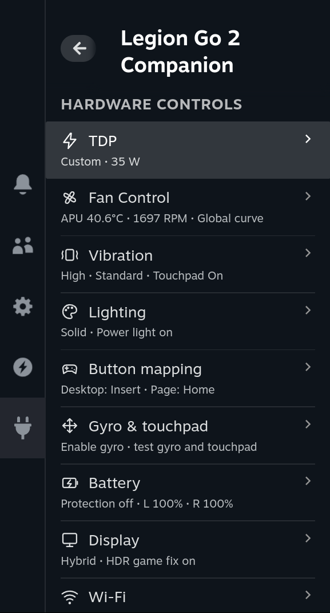</a>

1. Open **Manage Modules** and keep the modules you want to use.
2. For game-specific power or vibration, start the game first. On **TDP** choose **This game** under **Settings for &lt;game&gt;**; on **Vibration** turn on **Per-game profile**.
3. For custom cooling, open **Fan Control**, check the curve, save any edits, then turn on **Enable Fan Control**.
4. Results appear as short notifications. If something fails, the reason stays under that control; **Show details** at the end of each page has the technical facts.

Your settings stay saved across reboots and come back after sleep. Fan Control resumes your
curve after startup and sleep, but stays off after a detected fault until you turn it on again.

<details>
<summary><b>About the status summaries</b></summary>

The overview keeps the last received summaries when reopened. A note about old data means a
fresh status could not be confirmed yet. Dropdown selections keep you on the current page.
The screenshots in this guide are full 1920 × 1066 PNGs: click one to open it.

</details>

## Using the modules

### Manage Modules

Turn a module off to stop its work, give its hardware back to the system and hide its page.
Its settings are kept for when you turn it on again.

<a href="docs/screenshots/manage-modules.png">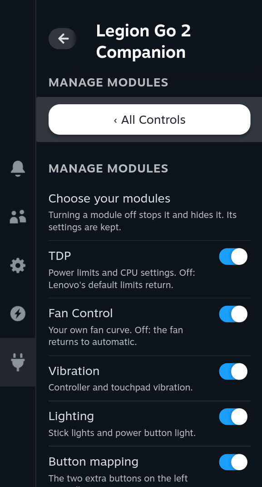</a>

<details>
<summary><b>What each module restores when turned off</b></summary>

This differs from turning off a single setting: for example, **Stick lights** can stay off
while lighting control stays active to keep them off after wake.

| Module | When turned off |
|---|---|
| TDP | Restores the platform profile, CPU Boost and EPP found before Companion first changed them; without them, Balanced, Boost on and `balance_performance` |
| Fan Control | Returns the fan to firmware automatic. Curves, assignments and units are kept; turning the module on again does not start the curve |
| Vibration | Restores the vibration settings found before Companion first changed them, otherwise the driver defaults |
| Lighting, Button mapping, Gyro & touchpad, Battery | Restores the previous state for controls Companion still manages |
| Wi-Fi | Restores the configuration Companion changed; Wi-Fi may briefly reconnect |
| Display | Withdraws display adjustments and its script; Gaming Mode may need a restart |

If cleanup cannot finish, the module stays blocked and offers **Retry &lt;module&gt; cleanup**.
A module that could not start offers **Retry &lt;module&gt; start**. Unfinished cleanup is
retried on startup. **Restart Gaming Mode** asks first: it ends the current gaming session.

</details>

### TDP

Turn on **Enable TDP control**, then pick a preset. The line under the switch shows what runs
now (Global or the game, the preset, the power limit and the live APU power).

<a href="docs/screenshots/tdp.png">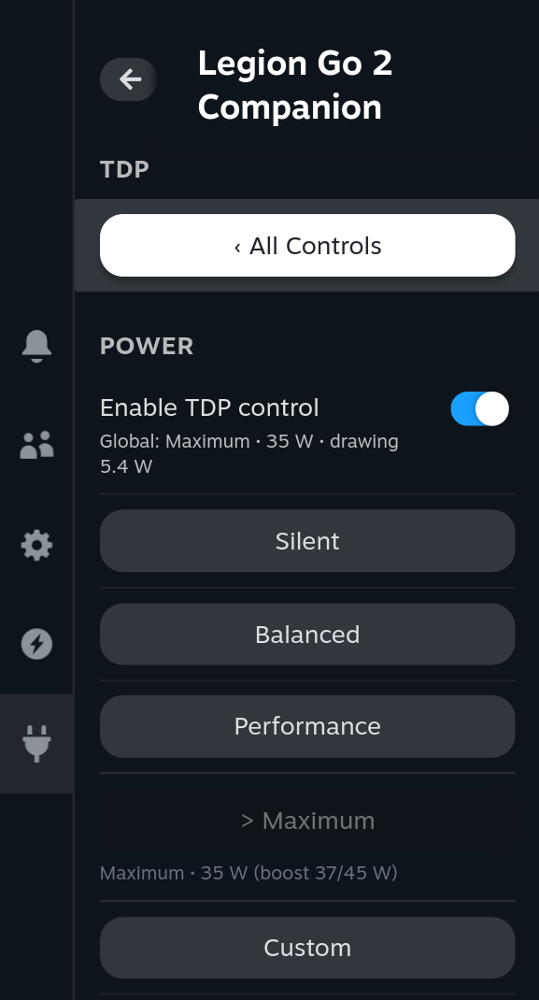</a>

| Preset | Sustained | Slow boost | Fast boost |
|---|---|---|---|
| Silent | 8 W | 15 W | 20 W |
| Balanced | 16 W | 25 W | 30 W |
| Performance | 20 W | 32 W | 35 W |
| Maximum | 35 W | 37 W | 45 W |

- A preset applies and saves as soon as you press it.
- **Custom** opens sliders for your own limits; press **Apply** to use them.
- **Settings for &lt;game&gt;** (while a game runs) chooses **Global**, **This game**, or
  **This game + charger** for different settings on battery and on charger.
- **CPU Boost** turns turbo frequencies on or off. **CPU energy preference** leans towards
  CPU speed (left) or leaves more power for the GPU (right).

> [!WARNING]
> **Allow up to 50 W** (under **More**) raises the boost limits beyond Lenovo's normal range.
> Sustained power stays at the firmware's limit (35 W on the Legion Go 2); the processor does not
> accept more. The console gets hotter and louder and the battery drains faster. It downloads and verifies the `ryzenadj`
> helper from GitHub the first time you turn it on.

<details>
<summary><b>Custom limits, boosts and game profiles in detail</b></summary>

Sustained power (SPL) is the main limit; slow and fast boost (SPPT and FPPT) allow more power
for slower and shorter bursts. These are APU limits, not the whole console's consumption.

Custom limits are a draft: the section title shows **· unsaved** until you press **Apply**
(**Apply for &lt;game&gt;** or **Apply for &lt;game&gt; on charger**, depending on what you edit).
Picking a preset drops an unsaved draft.

**Separate boost limits** (under **More**) is on by default and shows all three limits. Turn it
off for one **Sustained power** slider: normally 5–35 W, with slow boost following at +10 W up
to 37 W and fast boost at +15 W up to 45 W. The available range is checked against your
firmware. **Show details** lists the limits now in effect.

With **This game + charger**, **Edit settings for** picks **Battery** or **Charger**; it starts on
the power source in use now. The charger decides which settings run; editing the other one
saves it for later. Choosing **Global** keeps the game's own settings unused; choose
**This game** again to bring them back. **Delete profile for &lt;game&gt;** removes them after a
confirmation. A game's own settings start as a copy of the global ones; older profiles without
CPU settings use the global CPU choices until edited.

Newer kernels show **CPU energy preference** as a 0–100% slider in 10% steps; older kernels show
named preferences, including **System default** when available. CPU changes apply and save at
once for the settings chosen above.

**Separate battery presets** (under **More**, off by default) makes Silent, Balanced and
Performance use the lower limits the firmware sets on battery, and their usual values on the
charger; Maximum and Custom are unchanged. Off, the presets use the charger values on battery too.

Turning **Allow up to 50 W** off lowers saved boosts above the standard limits. If the helper is
unavailable, the normal range and your profiles stay available; use **Retry helper download**
when offered. If status or a profile could not load, use **Retry status** or **Retry profile**.

</details>

### Fan Control

Fan Control starts with the **Balanced** curve and stays off until you turn it on.

<a href="docs/screenshots/fan-control.png">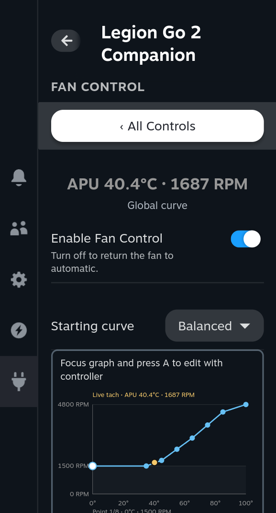</a>

1. Check the curve, adjust it if you like and press **Save global curve**.
2. Turn on **Enable Fan Control**. Turn it off at any time to return to the fan's automatic mode.

The graph has **8 points from 0 to 100°C**. Drag a point, or focus the graph and use the controller:

| Control | Action |
|---|---|
| A | Start editing points |
| LB / RB | Select the previous / next point |
| D-pad left / right | Change the temperature by 1°C |
| D-pad up / down | Change the speed by the selected step |
| B | Finish editing |

**Starting curve** offers **Silent**, **Balanced** and **Aggressive** as starting points to edit.
**Full screen curve editor** gives you more room.

<a href="docs/screenshots/fan-curve-editor.png">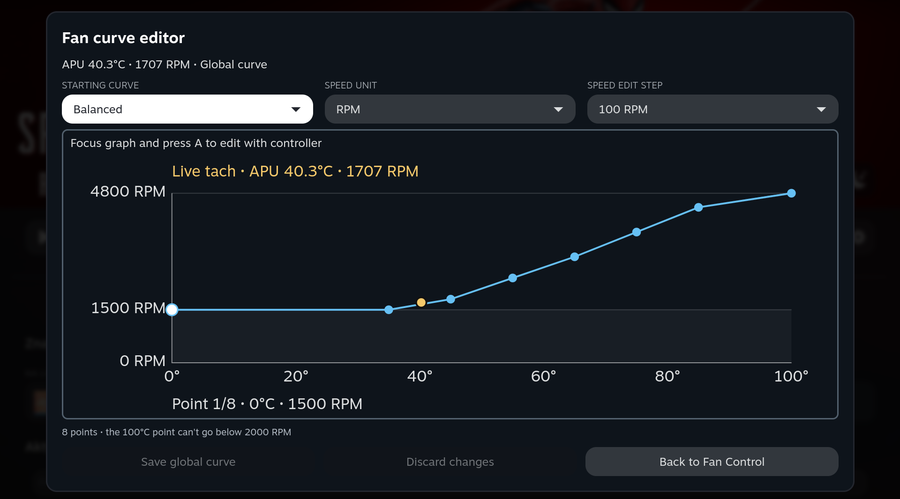</a>

<details>
<summary><b>Curve rules, readings and units</b></summary>

Move the first seven points freely; the last stays at **100°C** and only its speed changes,
never below **2000 RPM**. At 100°C the fan runs at full speed whatever the curve says.
Temperatures stay in order and speeds can only stay equal or rise with temperature; the
editor stops a point from crossing its neighbours. Positive speeds below 1500 RPM are
skipped; **0 RPM** requests a real stop.

**Speed edit step** starts at 100 RPM. **Discard changes** returns to the saved curve. Unsaved
drafts are kept while you switch curves or open the full-screen editor; save them before
leaving the page. Saving while Fan Control is off does not start it; when it is on, saving the
active curve updates the fan at once. Templates are Companion's starting points, not Lenovo
firmware profiles.

The page shows the **measured fan speed**, separately from the requested curve, also in
automatic mode. **APU** means the higher of **CPU Tctl and GPU edge**. Missing or stale readings
show a dash. **Show fan speed as percentage** (in **Settings**) changes the unit everywhere;
**100% means 4800 RPM**, the tested ceiling.

</details>

<details>
<summary><b>Different curves per TDP preset</b></summary>

The global curve is used unless **Settings → Assign curves to TDP presets** is on. Turn it on
to choose **Global**, **Silent**, **Balanced**, **Performance**, **Maximum** or **Custom** in
**Curve**, edit points and use **Assign curve to &lt;preset&gt;**. Selecting a row only chooses
what you edit. An unassigned preset uses the global curve; **Use global curve for
&lt;preset&gt;** removes an assignment. Assignments follow **Companion's TDP presets**, including
those chosen by game and charger profiles, **not SteamOS's own Performance profiles**.
Turning assignments off keeps saved curves and uses only the global curve.

</details>

<details>
<summary><b>What happens on sleep, restarts and errors</b></summary>

Once enabled, your curve keeps running across Gaming and Desktop Mode. Sleep, shutdown and
plugin restarts briefly return the fan to automatic; the page shows **Starting your curve…**
or **Paused, resuming automatically** until the curve is active again.

A short internal error (a slow sensor read or a momentary EC access error) restarts the
controller up to three times in ten minutes before Fan Control turns itself off with the
reason. Hardware evidence, such as a stalled fan, another program's fan override or a failed
readback, turns it off at once. If the page says **Another app controls the fan**,
**Returning fan to automatic…** or **Turned off after an error**, see
[Troubleshooting](#troubleshooting). The technical background is in
[Fan Control internals](#fan-control-internals-and-limits).

</details>

### Vibration

Set **Vibration strength** for both handles (Off, Low, Medium, High) and a **Vibration mode**
pattern (for example FPS, Racing, Standard, SPG or RPG). **Touchpad vibration** and
**Touchpad strength** are separate. **Test vibration** plays a short buzz.

<a href="docs/screenshots/vibration.png">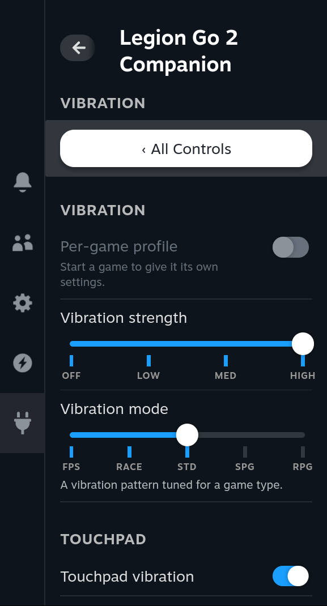</a>

Changes save automatically. With a game running, **Per-game profile** gives that game its own
settings; they apply whenever the game starts.

<details>
<summary><b>More vibration options</b></summary>

- **Reset to defaults** resets the selected global or game profile.
- **Show details** shows the controller driver and its endpoints.
- **Retry settings** reloads the settings after a load failure.

The available modes come from the controller driver. Saved vibration settings are reapplied
after controller reconnection and wake.

</details>

### Lighting

Turn on **Enable lighting control**, switch **Stick lights** on or off and choose an **Effect**:

| Effect | Controls |
|---|---|
| Solid | Hue, saturation and brightness |
| Breathing | Hue, saturation, brightness and speed |
| Color cycle | Brightness and speed |
| Rainbow | Brightness and speed |

<a href="docs/screenshots/rgb-lighting.png">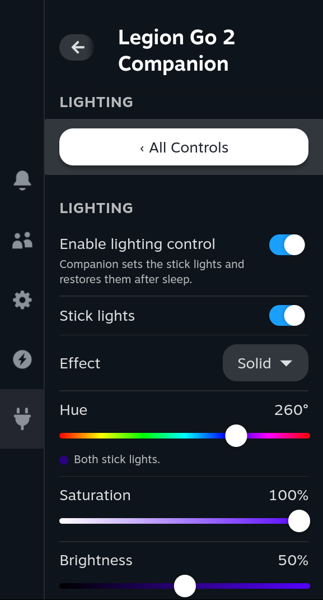</a>

Changes save automatically and come back after startup and wake. **Power button light**
switches the light in the power button (83N0 model). **Restore original lighting** returns the
lights to how they were before Companion.

<details>
<summary><b>Lighting details</b></summary>

The dot in the Hue description shows the chosen colour. The controller runs the animations
itself. Saved settings, including lights off, are reapplied when the controller becomes
available. The power-button light needs the BIOS to describe the light as explained in
[Requirements](#requirements). Restore original lighting also ends Companion's lighting control.

</details>

### Button mapping

Turn on **Enable button mapping**, then choose actions for the left controller's
**Desktop button** (upper extra button) and **Page button** (lower extra button): Steam menus,
the on-screen keyboard, screenshots, window switching, navigation keys, F1–F12 or **Disabled**.

<a href="docs/screenshots/button-remapper.png">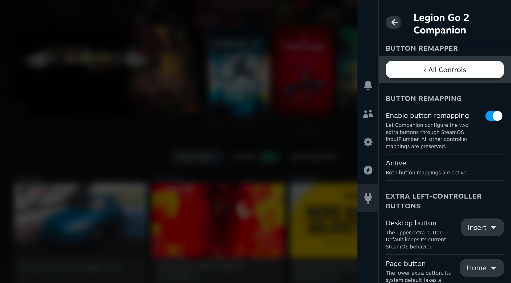</a>

**Default** restores a button's original action and **Restore defaults** restores both.

<details>
<summary><b>How mappings are applied</b></summary>

Actions are saved and applied through SteamOS's own InputPlumber service. Turning mapping off
restores the mappings Companion still manages and keeps unrelated mappings and changes made
elsewhere.

</details>

### Gyro & touchpad

Choose the **Gyro source**: **Left controller**, **Right controller**, **Both controllers** or
**System default**. The gyros are in the removable handles; Both averages them.

<a href="docs/screenshots/gyro-touchpad.png">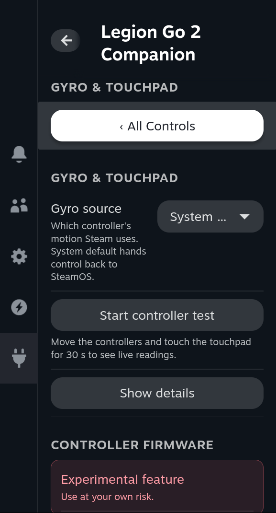</a>

**Start controller test** shows live gyro and touchpad readings for 30 seconds, from the
controllers and as Steam receives them, so you can see whether input reaches Steam. A game
still needs gyro or touchpad assignments in its Steam Input layout.

<details>
<summary><b>Gyro and test details</b></summary>

Selecting a controller turns on its gyro reporting and routes its motion through InputPlumber.
Until the route is confirmed, the description says **Not confirmed yet…**; **Show details**
shows the current route. **System default** restores the previous settings Companion still
manages. If an interrupted change is reported, use **Restore previous controller settings**
before making another change.

The test only reads existing reports: it does not turn on sensors, calibrate the console or
configure games. **Stop test** ends it early; it also stops when the page is hidden. Zero
readings and missing reports are shown separately. Raw values are diagnostic counts, not
degrees per second.

</details>

### Controller firmware

At the end of the **Gyro & touchpad** page (its own menu entry when that module is off), one
button walks you through **Check for updates**, **Download** and **Install**. Companion asks
Lenovo's update service for the newest left controller, right controller and receiver
firmware and installs every newer part in one go.

> [!IMPORTANT]
> Connect the charger (on battery, Install needs at least 30% charge), keep both controllers
> attached and do not put the console to sleep. Install refuses a controller that is detached
> or below 30% battery. It can take up to about five minutes and the
> controllers may disconnect briefly. This feature is marked experimental.

<details>
<summary><b>How firmware updates work</b></summary>

Companion asks Lenovo's Legion Space update service for the current firmware, downloads and
verifies every image with Lenovo's signing key, and installs the newer ones (left, right, then
receiver) with SteamOS's own fwupd tool. Its own controller features pause during the install,
and the new versions are checked afterwards. Only versions newer than the installed ones are
offered. If an update fails, check again and retry, or use Legion Space on Windows. Details:
[CONTROLLER_FIRMWARE.md](docs/CONTROLLER_FIRMWARE.md).

</details>

### Battery

The first row shows the console battery, charging status and both controllers.
**Battery protection** limits charging to **about 80%** using Lenovo's Long Life mode.

<a href="docs/screenshots/battery.png">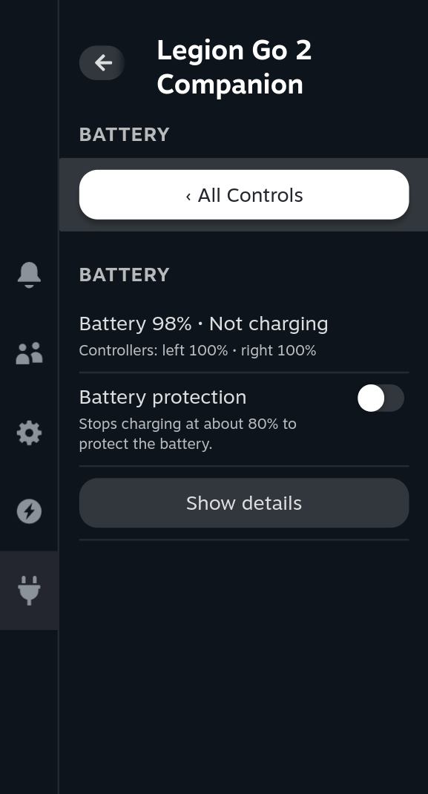</a>

<details>
<summary><b>Battery details</b></summary>

The percentage is fixed by the firmware. If the battery is already above it, protection does
not discharge it. Turning protection off restores the previous normal charging mode, including
**Fast** when it was active. **Restore previous charging mode** (under **Show details**) returns
the original state and stops Companion managing it; if a change was interrupted, the page asks
you to use it first. Until the battery confirms a change, the switch says
**Waiting for the battery to confirm…**. A fresh install leaves the charging mode alone until
you choose. Detached controllers are labelled, with their last reported level when available.

</details>

### Display

**Fix HDR brightness in games** corrects the brightness information (EDID) that games read, so
HDR games use the panel's real values. Restart a game that was already running.

<a href="docs/screenshots/oled-display.png">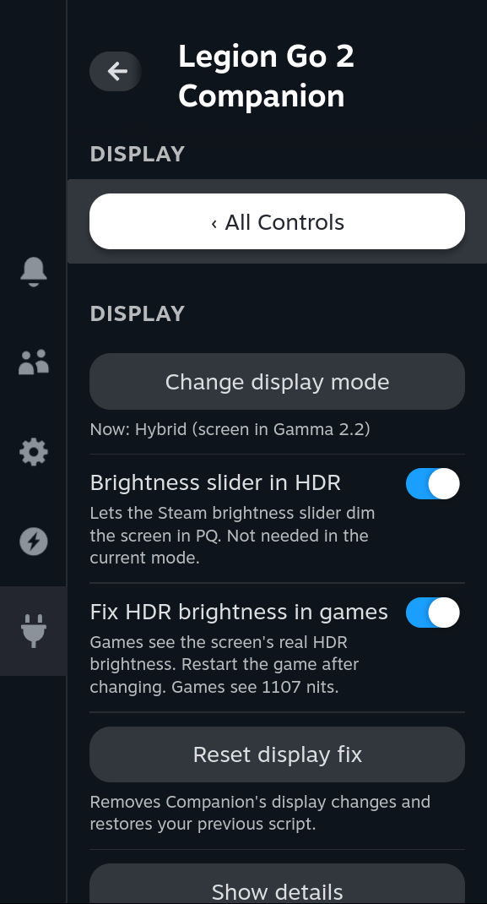</a>

**On SteamOS 3.9 and newer**, SteamOS supports this screen itself: the page says
**SteamOS supports this screen** and only the HDR fix stays. **On older SteamOS**, choose a
screen mode at first setup (it asks before installing), or later with **Change display mode**:

| Mode | What it does | What you may notice |
|---|---|---|
| Hybrid (recommended) | Gamma 2.2 for normal content, PQ for HDR | The screen briefly blanks when it switches |
| PQ | Keeps the panel in HDR mode | Dark scenes can look slightly grey |
| Gamma 2.2 | Keeps direct brightness control | HDR highlights are less bright |

> [!IMPORTANT]
> **Restart Gaming Mode** asks first, then closes Steam and running games. Save your games first.

<details>
<summary><b>Display details</b></summary>

When SteamOS ships its own Legion Go 2 display profile, Companion retires its older fix,
removes its own display script and hides PQ, Gamma 2.2, Hybrid and brightness forwarding.
Cleanup retries automatically; use **Restart Gaming Mode** when asked to finish the handover.

**Brightness slider in HDR** forwards Steam's brightness slider while the panel is in PQ and
Steam does not already handle HDR brightness; its description says when it is not needed.
Hybrid and PQ can switch immediately; changing to or from Gamma 2.2 can need a restart.

The HDR fix changes gamescope's copy of the EDID, never the panel firmware, and works
independently of the screen mode. On systems using the older fix, **Reset display fix** (after
a confirmation) removes Companion's brightness, HDR and EDID changes and its script, restores a
previous third-party script from backup if present, and returns to first setup. An unfinished
reset stays paused and offers **Retry display reset**.

</details>

### Wi-Fi

The first row shows your network, band and channel. Pick a policy in **Band**:

| Option | What it does |
|---|---|
| Automatic | SteamOS chooses the band |
| Prefer 5/6 GHz | Favours the faster bands, keeps 2.4 GHz as a fallback |
| Only 5/6 GHz | Never uses 2.4 GHz; asks first, because you can lose Wi-Fi away from a 5/6 GHz router |
| Only 6 GHz | Connects only to 6 GHz; asks first. Needs SteamOS 3.9 or newer |

<a href="docs/screenshots/wifi.png">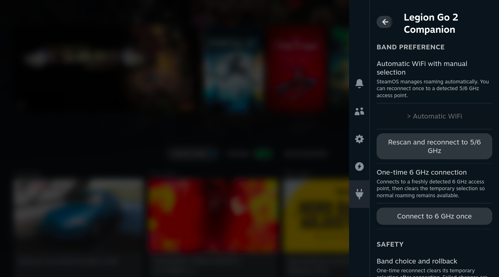</a>

If you lose Wi-Fi with a strict option, choose **Automatic** or **Prefer 5/6 GHz** again.

<details>
<summary><b>Wi-Fi details by backend</b></summary>

The options depend on SteamOS's Wi-Fi backend (**iwd** or **WPA supplicant**, shown under
**Show details**) and need the Legion Go's MT7922 adapter (`mt7921e` driver).

| Backend | Option | Behaviour |
|---|---|---|
| iwd | Band: Prefer 5/6 GHz | Favours higher bands while keeping 2.4 GHz available |
| iwd | Band: Only 5/6 GHz | Excludes 2.4 GHz; can leave Wi-Fi disconnected outside higher-band coverage |
| iwd with Prefer, or WPA with Automatic | Reconnect to 5/6 GHz | A one-time attempt to connect to a detected higher-band access point |
| WPA with Automatic | Connect to 6 GHz once | Connects to a detected 6 GHz access point, then returns to normal roaming |
| WPA with Automatic | Band: Only 6 GHz | Limits the saved network to 6 GHz; needs NetworkManager 1.58 or newer |

**Automatic** restores the band settings Companion changed. A saved policy is not proof of the
current connection; check the live band. With **Prefer 5/6 GHz** on iwd, Companion also looks
for higher-band access points and moves the connection automatically. WPA uses SteamOS's normal
roaming; its manual actions are one-time attempts.

If the first attempt of **Only 5/6 GHz** connects to no higher band, the previous policy comes
back automatically. Manual reconnect actions briefly interrupt Wi-Fi. If SteamOS switches
backend, a saved iwd preference stays visible but unused under WPA; choose **Automatic** to
clear it. Companion never switches the backend or runs another Wi-Fi manager.

</details>

### About

**About** shows the installed version, author and license, and checks for updates as
described in [Updating](#updating). **Save device report** is described in
[Reporting a problem on Legion Go / Go S (beta)](#reporting-a-problem-on-legion-go--go-s-beta).

## Desktop app

In Desktop Mode, **Legion Go Companion** is in the application menu. It has the same modules
and settings as the Decky panel, laid out for a mouse and a wide window, and both always show
the same state.

- When Desktop Mode starts, the app waits in the system tray; click the icon to open it.
- The TDP page lists every game that has its own settings, by name. **Edit** changes a game's
  settings even when it isn't running; **Delete** removes them.
- **About → View logs** shows recent events and can export them for a bug report.

<a href="docs/screenshots/desktop-tdp.png">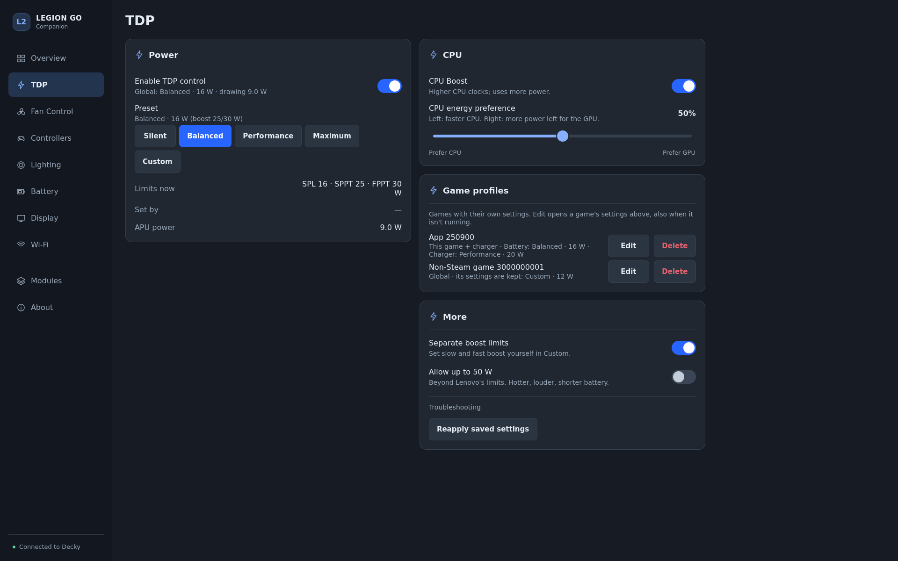</a>

<a href="docs/screenshots/desktop-fan.png">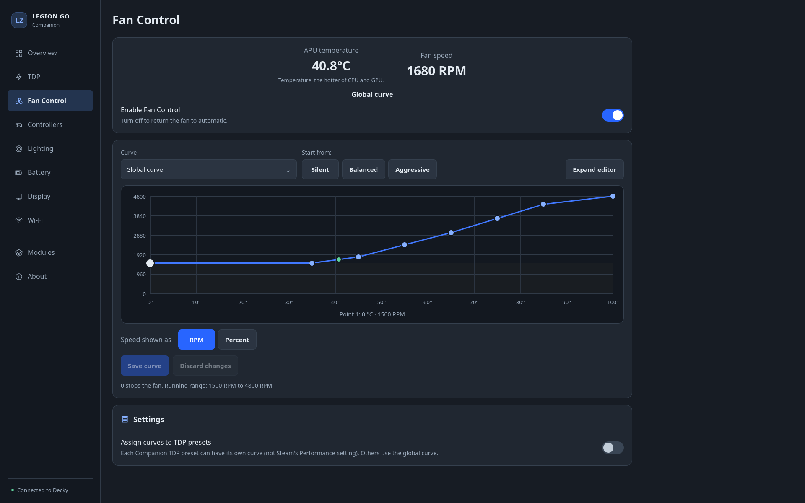</a>

<details>
<summary><b>Desktop app details</b></summary>

The app talks to the running Decky plugin. If Decky is not running, the app pauses its controls
and offers **Check Decky** and, when the service is stopped, **Start Decky**. Turning off
**Show tray icon** in the app's settings also stops the start in the tray. Editing a saved game
profile never changes the settings running now; they apply when that game starts. Uninstalling
the plugin closes the app and removes its menu and autostart entries; updating the plugin
restarts it in the new version. Logs are described in [LOGGING.md](docs/LOGGING.md).

</details>

## Troubleshooting

| What you see | What to do |
|---|---|
| All modules paused | Uninstall LeGoTDP, LeGo Vibe Control and LeGo2 Brightness Fix, then restart Decky or the console. |
| A module is missing | Check **Manage Modules**: a disabled module is hidden; a failed start or cleanup has a retry button there. |
| A control is unavailable | Read the reason on the page; some controls need system drivers or a specific model. |
| Fan Control is not available | Check your model in [Requirements](#requirements). |
| Another app controls the fan | Stop the other fan tool and let it return the fan to automatic. |
| Fan Control turned off after an error | Read the reason, let recovery finish, check your curve, then turn it on again. |
| Turned off: the BIOS/EC version changed how the fan is controlled | The check after a firmware update failed. Turn Fan Control on again to repeat it; if it keeps failing, report it with your BIOS and EC versions. |
| My curve is saved but the fan is on Automatic | Saving does not turn Fan Control on. Turn on **Enable Fan Control**. |
| A curve point will not move further | Temperatures stay in order and speeds cannot drop between points; the last point stays at 100°C and at least 2000 RPM. |
| The gyro test works but the game does not react | Check that game's Steam Input layout. |
| The controllers stopped working, often after sleep | Companion restarts SteamOS's InputPlumber by itself when it has lost the controllers (at most once per 10 minutes, and three times until Decky or the console restarts); if they still do not respond, restart the console. |
| Battery stays above 80% with protection on | Normal: protection stops charging, it does not discharge the battery. |
| A game still reads old HDR values | Turn on **Fix HDR brightness in games** and restart the game. |
| Wi-Fi stays on 2.4 GHz | Check the live band; use **Reconnect to 5/6 GHz** when offered. A setting cannot create a missing 5/6 GHz network. |
| No Wi-Fi with Only 5/6 GHz or Only 6 GHz | Choose **Automatic** or **Prefer 5/6 GHz**. |
| Update check or download failed | Read the error and retry, or download the ZIP from Releases and install it manually. |
| The Desktop app says Qt is missing or too old | Use the Decky panel; the app needs SteamOS 3.8 or newer. |

<details>
<summary><b>More troubleshooting</b></summary>

| What you see | What to do |
|---|---|
| A preference is saved but not confirmed | Check the current state and the error; wait for recovery or use the offered retry. An unavailable reading is not treated as on or off. |
| 50 W is paused | Keep using the normal range. Connect to the internet and use **Retry helper download**; your profiles are kept. |
| Returning fan to automatic… | Let it finish. Keep custom control off if recovery cannot be confirmed. |
| Fan Control reports a watchdog connection failure | This is communication between local processes; the fan still returns to automatic. Include the reason and, before rebooting, the output of `sudo cat /run/legiongo2companion-fan/last-fault.json` (if it exists) in a report. |
| Fan RPM or APU shows a dash | The reading is unavailable or stale. Another program reading the EC can prevent a safe read. A dash does not mean the fan stopped. |
| Display controls are locked | Read the SteamOS-support or cleanup message and use the requested restart. |
| Recovery required, settings damaged or cleanup incomplete | Keep the saved settings and backups; follow the page's reason and retry button. Deleting them can remove what is needed to restore your previous state. |
| A plugin conflict persists | Renamed copies of the old plugins still count; keep backups outside Decky's plugin folder. If the plugin folder cannot be read, restore access to it. |
| The plugin folder was deleted by hand and the display or Wi-Fi still acts as if Companion were set | Install Companion again and uninstall it in Decky Settings; uninstalling restores what it changed. By hand: delete `~/.config/gamescope/scripts/lenovo.legiongo2.oled.lua` (rename a `lenovo.legiongo2.oled.lua.backup` next to it back to that name, if present), remove the `BandModifier2_4GHz` line from `[Rank]` in `/etc/iwd/main.conf` (iwd backend only), then restart the console. |

</details>

**Reporting a problem:** include the plugin version, SteamOS version, console model, what the
page says, when it happened and what you did, plus the logs from **About → View logs** in the
Desktop app or as described in [LOGGING.md](docs/LOGGING.md). [CHANGELOG.md](CHANGELOG.md) lists
the changes in each version.

### Reporting a problem on Legion Go / Go S (beta)

Companion has not been tested on the Legion Go, the Legion Go S or the Legion Go 2 Z2 (83N1) yet,
so reports from these consoles help most.

1. In Decky open Companion → **About** → **Save device report** (Desktop app: **About → View logs
   → Save device report**). A file `LegionGoCompanion-device-report-<date>-<time>.txt` appears on
   your Desktop.
2. Open a [Beta report](https://github.com/Rayekkk/LegionGo2Companion/issues/new?template=beta-report.yml),
   say what works and what does not, and attach the file.

The report is made on the console, without internet, and only reads. It lists the model and
firmware versions (DMI, BIOS and EC, firmware attributes, battery, controllers and their drivers,
sensors, the display's maker and model, the Wi-Fi adapter and its bands, fwupd devices), the
SteamOS, kernel, InputPlumber and fwupd versions, Companion's module status, and how many warnings
and errors Companion logged in the last 24 hours. It contains no serial numbers, MAC addresses,
network names, user names or log text. Open it in a text editor to check it before you send it.

## How it works

<details>
<summary><b>Hardware interfaces, recovery and background work</b></summary>

Companion coordinates independent hardware modules through Decky. Each module manages its own
settings and verifies the interface it uses.

| Area | System interface |
|---|---|
| TDP | Lenovo WMI in the firmware range; verified `ryzenadj` helper for Allow up to 50 W |
| Fan Control | Restricted EC access on the 83N0 model, checked by behaviour; k10temp and amdgpu temperatures plus EC tachometer feedback |
| CPU Boost / EPP | Kernel CPU policy controls under sysfs |
| Package power | RAPL energy counters |
| Haptics / joystick RGB | `hid-lenovo-go` sysfs controls |
| Button mappings | InputPlumber's D-Bus profile API |
| Controller gyro | Lenovo IMU bypass controls and InputPlumber D-Bus event filters |
| Passive diagnostics | Read-only copies of native and virtual controller HID reports during an explicit test |
| Battery protection | The kernel battery `charge_types` attribute |
| OLED | Gamescope display script, X properties and gamescope's published EDID copy |
| Wi-Fi | NetworkManager with the active iwd or WPA supplicant backend |

Display corrections change gamescope's EDID copy, not the panel firmware. Native-display
handover detects the system profile at
`/usr/share/gamescope/scripts/00-gamescope/displays/lenovo.legiongo2.oled.lua`. Detection checks
file presence, not Lua contents or SteamOS channel. The first handover requests a Gaming Mode
restart. See the [technical review](docs/NATIVE_DISPLAY_SUPPORT.md).

Settings use atomic replacement and backup/recovery handling. Failed changes retain restoration
information; controls pause if settings cannot be recovered. Restoration only changes state
still owned by Companion, preserving conflicting external changes. TDP/CPU and Vibration capture
the system's own values before their first change and restore them on withdrawal; installs from
before 2.2 without captured values fall back to the defaults listed under Manage Modules.
Interrupted cleanup is also retried during uninstall when Companion is not paused by a plugin
conflict.

Background profile and recovery checks continue with Quick Access closed. RGB and remapping
normally check once per minute, with five-second checks during the first 30 seconds after
startup or wake; matching state avoids another write or profile reload. Battery and gyro also
recover after startup and wake and check for drift. RGB retries a temporarily missing controller
during wake recovery. InputPlumber restarts trigger earlier recovery checks, with backoff after
failures.

Page refreshes pause while Quick Access is hidden. Diagnostic readers close outside a test;
controller battery sampling is a short read with a 15-second cache. RGB animations run in
firmware, and slider edits are grouped while a control is moving. Vibration discards superseded
queued values for the same field and profile while keeping the final accepted edit. Actual
overhead depends on enabled modules, display mode and the system build.

Conflict detection checks plugin folders and manifests, including renamed copies. It blocks
requests and stops workers when a conflict appears; a restart is required after removal. WiFi
Optimizer and HueSync are not part of that check.

The update downloader accepts stable release plugin ZIPs with a SHA-256 digest. It checks
version, size, digest and archive contents before completing the download. Source archives and
development branches are not used as fallback downloads.

</details>

### Fan Control internals and limits

<details>
<summary><b>EC access, temperature readings and recovery</b></summary>

Fan Control uses an independently implemented, restricted EC register interface on
[the validated hardware](#requirements). The positive target range is **1500–4800 RPM**;
unsupported positive values below 1500 snap to stop or the running minimum. Custom zero uses a
distinct EC stop request; a zero override releases control to firmware. Firmware automatic can
also naturally stop a cool fan.

The EC interface is checked by behaviour, not by version. Every session start first reads all
of the registers Companion uses twice, without writing. The readings must be stable and
plausible, and an override must be absent or released. On a BIOS/EC version pair that Companion
has not checked yet, the first session sets 3000 RPM (4800 RPM if the fan already runs at
2200 RPM or more). The target must read back exactly, and the tachometer must come within 15% of
it in two consecutive samples within 15 seconds. Release must then read firmware automatic three
times. The check never lowers the fan speed, and the backup watchdog runs throughout. The
checked pair is remembered in a root-only file outside Decky's settings folder
(`/var/lib/legiongo2companion-fan/fan_firmware.json`), so later sessions skip this check. It is
a hardware fact, so uninstalling leaves it in place. A failed check is not remembered: Fan
Control turns off with the reason, and enabling it again repeats the check.

**4800 RPM is an observed operating plateau on the tested unit, not a manufacturer motor rating
or a guarantee for every console.** Bounded trials through a 5200 RPM target produced no useful
increase. The editor's finer target steps do not imply one-RPM motor accuracy. Starting from stop
requests the curve's positive speed directly, without an artificial 4000 RPM kick; insufficient
tach feedback causes withdrawal rather than repeated hidden boosts.

Control and the displayed APU value use **max(CPU Tctl, GPU edge)** from k10temp and amdgpu.
The tested system exposes no Tdie or verified separate whole-package sensor. The EC temperature
is supplementary telemetry with an unproven physical sensor identity; its difference from
Tctl/GPU edge is not a fault. Invalid or slow sensor reads still withdraw control. A live
tachometer reading is never replaced by the requested RPM.

A separate controller process and an independent recovery process supervise fresh sensors,
progress and ownership. Cooling rises quickly and falls more slowly to limit oscillation. Custom
control follows the curve up to **100°C**; there, the controller and backup can enforce full
speed without the normal ramp. This policy is tested with model inputs, not by heating the
console to 100°C. Native thermal protections remain in place.

Disable, unload, SIGTERM, faults and normal sleep withdraw custom control and verify firmware
automatic. Both fan processes hold their own login1 delay inhibitor during sleep preparation.
Session endings are classified: sleep, shutdown and plugin restarts **pause** and then re-arm
the saved curve with a fresh controller; transient software or timing errors **retry** at most
three times in ten minutes; hardware evidence is a **fault** that saves Fan Control off with its
reason. Every start repeats all checks (platform, ownership, both sensors, EC plausibility,
backup readiness, sleep inhibitor, curve). The controller runs the curve from its own sensors,
so a busy or detached Decky frontend does not end the session. Detected conflicting owners or
unverifiable ownership block activation; a foreign raw-port reader can also block telemetry
without proving an active fan override. A leftover EC override with no live owner, for example
after both fan processes were killed, is released to firmware automatic when the next session
starts.

Recovery requires a functioning kernel and EC transport. Recovery after a whole-system hang and
a firmware-enforced lease have not been established. Userspace locks cannot exclude firmware/SMM
or every non-cooperating EC writer. Do not run another fan or EC control tool alongside
Companion's custom controller.

With custom control off, there are no fan workers or sleep inhibitors and no background EC
polling. Visible fan views request bounded passive readings; hiding them stops new requests.
Active control uses its own telemetry independently of the menu.

Saved fan settings use the format Fan Control shipped with in 2.1.0; any other format is
refused and custom control stays off until the curve is reviewed. Optional TDP
assignments remain dormant until explicitly enabled. Saving uses a revision check so an old
editor cannot overwrite newer settings.

See [SOURCE.md](SOURCE.md#fan-control-hardware-facts-and-independent-implementation) for
protocol provenance and the limits of the hardware evidence.

</details>

## Development

<details>
<summary><b>Build, test and package from source</b></summary>

The [Desktop app](#desktop-app) is written in **C++17 and Qt Quick/QML** and ships in the plugin
ZIP. It links SteamOS's system Qt (6.9 or newer) instead of bundling Qt, and calls the same
Python backend as the Decky panel over an authenticated loopback connection. See the
[Desktop app notes](docs/DESKTOP_UI.md) for its architecture, lifecycle, build and tests.

Requires Node.js 24, Git and `tar` (the packager writes the ZIP itself). Backend tests
require Python 3.10+. The native Desktop build additionally requires CMake, Ninja, a C++17 compiler and
a Qt 6.9 SDK.

```bash
npm ci
npm run typecheck      # frontend types
npm run test:frontend  # frontend regression suites
npm test               # Python backend tests
npm run build          # compile and validate the frontend
python scripts/build-native.py --qt /path/to/Qt/6.9.1/gcc_64 --build /tmp/companion-native --test --bundle dist/desktop
npm run test:desktop   # native API/source contract; Qt tests run in the command above
npm run package        # create LegionGo2Companion-<version>.zip and its .sha256
```

**Build before packaging:** package uses the existing frontend build and the native app in
`dist/desktop` from the command above (`npm run build` keeps `dist/desktop`). Tracked files come
from the committed `HEAD`, so the same commit and build give a byte-identical ZIP. Install the result through Decky; a source checkout with
`node_modules` is not an installation package.

GitHub Actions runs the backend tests on Linux/Python 3.10 and 3.14 and Windows/Python 3.13,
plus frontend tests, build and package validation on Node.js 24 LTS. The native app is built
against Qt 6.9.1 and its tests run again on the newest Qt 6. Linux-specific checks skip on
Windows. Hardware calls are mocked; device testing is still required for startup, wake, game
transitions and native Steam UI behaviour. CI does not publish releases.

The archive includes frontend source/build inputs, license notices and bundled pyudev source.
RyzenAdj is downloaded separately and verified against its pinned hash before every use. It is
kept in `/var/lib/legiongo2companion-tdp/`, outside Decky's plugin folder, so updates keep it;
uninstalling leaves it there. A Wi-Fi band change keeps a short rollback journal in
`/var/lib/legiongo2companion-wifi/` until the change has finished; the empty folder stays after
uninstalling. See
[SOURCE.md](SOURCE.md) for rebuilding and [NOTICE](NOTICE) for component provenance.

</details>

---

## Credits

- Andrii Dmytrenko ([@Antti](https://github.com/Antti)) - 8AHP2 / 83N1 joystick RGB support and owner testing in [PR #2](https://github.com/Rayekkk/LegionGo2Companion/pull/2)
- Ally Vibe Control by [piyush-tyagi-13](https://github.com/piyush-tyagi-13/ally-vibe-control), with original per-game profile work by M4ttiA - inherited MIT-licensed vibration code
- [HueSync](https://github.com/honjow/HueSync) by honjow and Steam Deck Homebrew - reference for the lighting interface and Go 2 sysfs controls
- [Rodpad/LeGo2-Fan-Control](https://github.com/Rodpad/LeGo2-Fan-Control) - published fan protocol/register facts used by Companion's independent implementation; no reference implementation was copied or adapted
- Armada Control - fan-editor UX reference; Companion's editor is independently designed and implemented, with no Armada code incorporated. See [SOURCE.md](SOURCE.md#fan-control-hardware-facts-and-independent-implementation)
- [RyzenAdj](https://github.com/FlyGoat/RyzenAdj), [pyudev](https://github.com/pyudev/pyudev), [InputPlumber](https://github.com/ShadowBlip/InputPlumber) and [Decky Loader](https://github.com/SteamDeckHomebrew/decky-loader) - the supporting tools and interfaces

Component licenses are recorded in [NOTICE](NOTICE); implementation and hardware-reference
provenance are described in [SOURCE.md](SOURCE.md).

---

## License

BSD 3-Clause - see [LICENSE](LICENSE). Inherited vibration code retains its
[MIT notice](LICENSE.MIT), and HueSync attribution is preserved in
[LICENSE.HUESYNC](LICENSE.HUESYNC). Third-party terms and source information are listed
in [NOTICE](NOTICE) and [SOURCE.md](SOURCE.md).

---

## AI disclaimer

This project was built with substantial help from AI coding assistants. Most of the code,
tests and documentation were written by AI agents (first OpenAI Codex, later Anthropic's
Claude Code) working under my direction: I defined what each feature should do, made the
design and safety decisions, reviewed the results and chose what was released.

The AI was used to:

- write and refactor the Python backend, the Decky panel and the native Desktop app;
- build the automated test suites (about 1,300 tests run on Linux and Windows for every change);
- audit the code for bugs, security issues and wasted work, with every finding checked by
  independent review passes and, where possible, reproduced before it was fixed;
- research hardware interfaces and write this documentation.

Nothing here is untested AI output. I tested the plugin continuously on my own Legion Go 2
throughout development: in Gaming and Desktop Mode, across sleep, restarts, plugin
updates and reinstalls, with games and HDR content, on SteamOS Stable (with a compatibility
check on the Beta), and with supervised controller firmware installs. Hardware-facing features (fan control, power
limits, display, firmware) were held back until they behaved correctly on the real device,
and safety rules such as releasing the fan to firmware control on any failure were kept as
hard requirements.

Even so, Companion controls power, cooling and firmware on your console. It is provided
as is, without warranty (see [License](#license)); use it at your own risk.
